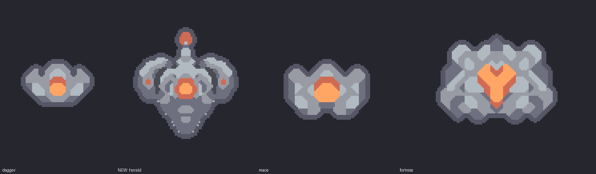

# FanPulse
**Plain-language player feedback → what players want → a verified change in the game's code.**

Players don't file tickets. They say "the waves get way too hard around wave 30" or "I want more cops". FanPulse:

1. **Collects** posts at volume through official APIs: Steam reviews, Reddit, Discord, Instagram/Facebook.
2. **Groups and ranks** them so one loud account or one viral meme can't game the list.
3. **Reads intent:** which way players want each thing to move (more or less), how strongly they agree, and *where* it hurts ("around wave 30").
4. **Traces it to code:** finds the numbers in the codebase that could control it, then **runs the game's own code** with each one nudged to see which actually move it.
5. **Proposes a change sized to the request,** with guardrails, measures it again on the real code, and outputs a `git apply`-ready diff.

## See the results
| What | File |
|---|---|
| Real Steam reviews → verified change to Mindustry's wave code | [`docs/results/trace_enemy_waves.md`](docs/results/trace_enemy_waves.md) |
| Feature request ("warn me before the boss") → drafted + verified code | [`docs/results/feature_boss_warning.md`](docs/results/feature_boss_warning.md) |
| New unit art: measured style guide → brief → generated → reviewed | [`docs/results/herald_lineup.png`](docs/results/herald_lineup.png), [`art_brief_herald.md`](docs/results/art_brief_herald.md) |
| Full write-up, including what didn't work | [`TRIAL_RESULTS.md`](TRIAL_RESULTS.md) |
| Playable mod: the Herald in Mindustry | [yugena/fanpulse-herald](https://github.com/yugena/fanpulse-herald) |



## The Mindustry trial (open-source game, real code)
```bash
pip install -r requirements.txt
games/mindustry/setup.sh                              # Mindustry v160.8 source + official server build + probe
python -m fanpulse.cli trace --config games/mindustry/game.toml
open out/mindustry/trace_enemy_waves.html
```
Result on the bundled demo reviews (feedback is synthetic, but the code search, patch and measurements are real):

- **Read the reviews:** 97 players want less, 22 want more, 37 unclear → **LESS** at 81% agreement (weighted and by headcount). Players say "around wave 30", so the tool targets **mid-game waves**, aiming for −17.4%.
- **Searched:** tested 80 numbers in `Waves.java` and nearby files by running Mindustry's real wave generator; 22 measurably moved the target.
- **Rejected levers with side effects:** for example, `rand.random(8, 16)` cut mid-game pressure but made late waves harder.
- **Proposed:** two edits in `core/src/mindustry/game/Waves.java`:
  - `shieldsPerWave = 20 + …` becomes `14 + …`
  - the "harder start" shift `14` becomes `7`
- **Measured on the patched game:** mid waves −17.0%, early −33.0%, late −22.6%, unit count −5.9%. The diff applies cleanly to a fresh v160.8 checkout.
- **Reverse check:** fed "too easy after wave 50" instead, it targets *late* waves and makes them harder (+27.6%) with a different lever (`shieldStart`).

### Real Steam reviews: see [TRIAL_RESULTS.md](TRIAL_RESULTS.md)
On 10,952 real reviews, Muse Spark read direction far better than keyword rules: it found 10 of 10 real requests on held-out hand labels, against 0 of 10 for the rules, and never reversed a direction. 110 players want waves easier and 34 harder, so the tool proposed starting enemy shields at wave 45 instead of 30. That measured −19.5% on late waves in Mindustry's real code, with early waves unchanged.

### Collecting the real reviews
Steam needs no API key. The fetcher uses only the standard library (Python 3.9+), so it runs on a stock Mac (double-click `Get Steam reviews.command`):
```bash
python3 -m fanpulse.collectors.steam --appid 1127400 --out reviews.json
python -m fanpulse.cli trace --config games/mindustry/game.toml --posts reviews.json
```
It uses Valve's current `IUserReviewsService/GetAppReviews` (the old `/appreviews` endpoint was retired in Oct 2026).

To have Muse read which way each player wants it to move (keyword rules can't, on real reviews), double-click `Label reviews with Muse.command`. It asks for your Meta Model API key, which is hidden, used for that run only and never saved. Or:
```bash
MODEL_API_KEY=... python3 -m fanpulse.cli label --config games/mindustry/game.toml --posts reviews.json
python3 -m fanpulse.cli trace --config games/mindustry/game.toml --posts reviews.json --labels out/mindustry/intent_labels_enemy_waves.json
```

## Feature requests: new behaviour, not just tuning
Players also ask for things that don't exist yet. A **feature spec** (`games/<game>/features/<id>.toml`) records the request, the real player quotes, and acceptance checks the probe can measure. Then:
```bash
python3 -m fanpulse.cli draft  --config games/mindustry/game.toml --spec games/mindustry/features/boss_warning.toml   # LLM drafts edits
python3 -m fanpulse.cli verify --config games/mindustry/game.toml --spec ... --draft out/mindustry/feature_boss_warning_draft.json
```
The tool locates the code from the players' own words, the LLM returns exact find/replace edits, and `verify` compiles and runs the real game to check every criterion. A failed verification can be fed back with `draft --previous`. On a Mac: double-click `Draft feature with Muse.command`. Results for "warn me before the boss" are in TRIAL_RESULTS.md.

## New content needs art: style guide → brief → any image generator → review
```bash
python3 -m fanpulse.cli art --config games/mindustry/game.toml --spec games/mindustry/art/herald.toml                 # guide + brief + prompt
python3 -m fanpulse.cli art --config games/mindustry/game.toml --spec games/mindustry/art/herald.toml --image gen.png # conform + review
```
The style guide is **measured** from the game's own sprites (palette, colours per sprite, edges, symmetry, lighting, facet size, accent share, size by tier) plus outline rules read from the code. The reviewer is calibrated so it accepts the game's own art (48/58 Mindustry units). The brief works for any generator: Canva here, or Retro Diffusion, PixelLab or Scenario in production.

## How tracing works (and its guardrails)
| Step | What happens |
|---|---|
| Vocabulary | Theme title plus the words players use *distinctively* for this theme, bridged to dev terms ("enemies" → spawn/unit/wave, "hard" → health/shield/scaling) |
| Candidates | TF-IDF ranks source files; numeric literals near those terms become candidates (`codeindex.py`) |
| Probe | Each candidate is nudged +25% and the game's code runs in an isolated copy; only measurable effects survive |
| Confidence gate | No change unless 30+ players clearly ask and 60%+ agree, both weighted and by headcount |
| Safety | Skip levers that push any other metric against the players' request; never more than halve or double a number |
| Sizing | Target = 5–25%, scaled by agreement; secant search per lever; stack up to 3 safe levers until within 20% of target |
| Verify | Final patch re-measured; unified diff emitted; nothing touches the real repo |

**The probe is the one per-game piece.** A small harness runs the relevant system headless and prints metrics. For Mindustry that's `games/mindustry/WaveMetric.java` (enemy count × health and shields across 15 generated wave sets). `Probe.java` is generic for any JVM game: it compiles patched files against the release jar and runs each variant in its own class loader. A studio would point this at its own headless simulation or bots.

**Honest limits.** The metric measures enemy pressure, not a full playthrough. Levers the probe can't see (for example time between waves, which lives in `Rules.java`) aren't verified. Intent from keyword rules is **not reliable on real reviews** (see TRIAL_RESULTS.md); set `MODEL_API_KEY` for LLM classification and re-measure against `data/real/enemy_waves_labels.json` before trusting it. Every diff is for a human to review.

## GTA VI demo (launch-week themes + authored proposals)
`python -m fanpulse.cli scan` uses `games/gta6.toml` and the synthetic GTA posts. The C++ in `proposals/code/` is engine-agnostic illustration, not Rockstar code.

## Layout
```
fanpulse/collectors/  steam · reddit · discord_api · meta_graph · demo   (official APIs only)
fanpulse/analyze.py   classify → cluster → rank; intent (more/less, agreement)
fanpulse/codeindex.py where in the code a theme might live
fanpulse/tracer.py    probe, guardrails, sizing, diff, trace report
fanpulse/feature.py   feature specs: locate code, LLM draft, apply, verify against checks
fanpulse/art.py       measured style guide, designer brief, conform + calibrated review, in-game lineup
fanpulse/muse_connector.py  MCP server for Meta Muse (incl. get_code_change)
games/<game>.toml     sources, themes, probe; one file per game
games/mindustry/      Probe.java (generic JVM runner), WaveMetric.java, setup.sh
```

## Data
The 10,952 Steam reviews used in the trial are **not** in this repo; they're other people's posts. Re-collect them with `python3 -m fanpulse.collectors.steam --appid 1127400 --out reviews.json`. `data/real/` holds only the hand labels and Muse's labels (by Steam review ID), so the accuracy numbers can be reproduced.

## License
MIT, except `games/mindustry/` (the probe, metrics, mod and patches), which derives from [Mindustry](https://github.com/Anuke/Mindustry) and is GPL-3.0.

## Tests
```bash
python -m pytest -q tests                        # fast unit tests
FANPULSE_IT=1 python -m pytest -q tests          # + end-to-end Mindustry trace (~1 min)
cd proposals/code && g++ -std=c++17 -Wall -Wextra -O2 *.cpp -o t && ./t
```
